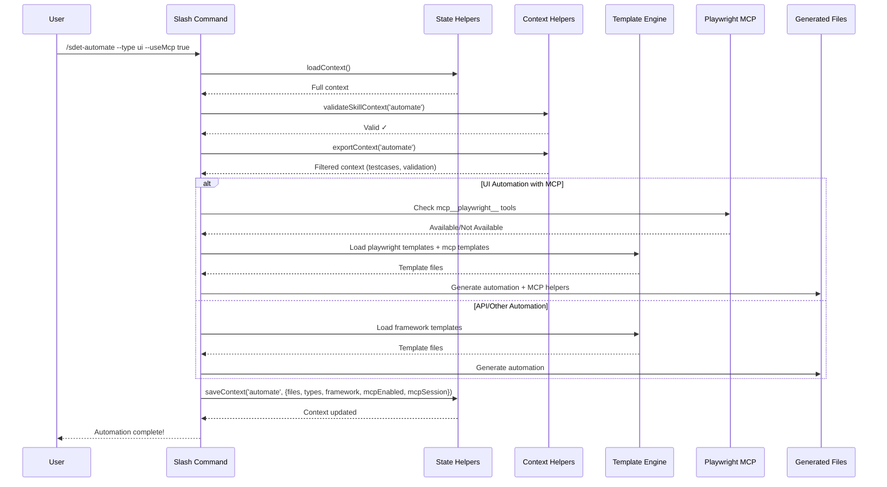

# SDET Agent Skill - Deep Architecture Documentation

## Overview

This document provides a comprehensive deep-dive into the architecture of the SDET Agent Skill system - a modular, skill-based testing automation framework built for Claude Code.

---

## Table of Contents

1. [System Architecture](#system-architecture)
2. [Core Components](#core-components)
3. [Skill Pipeline](#skill-pipeline)
4. [Shared Context System](#shared-context-system)
5. [MCP Integration Architecture](#mcp-integration-architecture)
6. [Template System](#template-system)
7. [Execution Flow](#execution-flow)
8. [Extension Points](#extension-points)

---

## System Architecture

### High-Level Design

```
┌─────────────────────────────────────────────────────────────────────────────┐
│                         SDET AGENT SKILL SYSTEM                             │
├─────────────────────────────────────────────────────────────────────────────┤
│                                                                             │
│  ┌──────────────┐    ┌──────────────┐    ┌──────────────┐    ┌──────────┐  │
│  │   CLI /      │    │   Skill      │    │   Context    │    │ Template │  │
│  │   Slash      │───▶│   Engine     │───▶│   Manager    │───▶│  Engine  │  │
│  │   Commands   │    │              │    │              │    │          │  │
│  └──────────────┘    └──────────────┘    └──────────────┘    └──────────┘  │
│         │                   │                   │                   │       │
│         ▼                   ▼                   ▼                   ▼       │
│  ┌──────────────────────────────────────────────────────────────────────┐   │
│  │                    SHARED CONTEXT STORE (.claude/context/)           │   │
│  │  ┌──────────┐ ┌──────────┐ ┌──────────┐ ┌──────────┐ ┌──────────┐  │   │
│  │  │ analyze  │ │ generate │ │ validate │ │ automate │ │ execute  │  │   │
│  │  └──────────┘ └──────────┘ └──────────┘ └──────────┘ └──────────┘  │   │
│  └──────────────────────────────────────────────────────────────────────┘   │
│                                                                             │
└─────────────────────────────────────────────────────────────────────────────┘
```

### Architectural Principles

1. **Skill-Based Modularity**: Each testing capability is a self-contained skill
2. **Context-Driven**: All state flows through a shared JSON context store
3. **Template-Driven Generation**: Code generation uses parameterized templates
4. **MCP-Native**: First-class support for Model Context Protocol servers
5. **Incremental**: Skills only process new/changed artifacts
6. **Composable**: Skills can be chained into pipelines

---

## Core Components

### 1. Slash Commands (`.claude/commands/`)

Each skill is exposed as a slash command with frontmatter metadata:

```markdown
---
name: sdet-automate
description: Generate automation code from test cases
arguments:
  - name: type
    description: Automation type
    required: false
    default: all
  - name: useMcp
    description: Enable Playwright MCP
    required: false
    default: "true"  # ← Default enabled
---
```

**Key Files:**
- `sdet-automate.md` - Main automation skill
- `sdet-analyze.md` - Requirements analysis
- `sdet-generate.md` - Test case generation
- `sdet-validate.md` - Test case validation
- `sdet-execute.md` - Test execution
- And 40+ more skills...

### 2. State Helpers (`scripts/state-helpers.js`)

Central context management:

```javascript
// Core functions
loadContext()           // Load full context from .claude/context/sdet-context.json
saveContext(skill, output)  // Save skill output to context namespace
validateContextForSkill(context, skillName)  // Validate required keys
getContextValue(context, path)  // Dot-notation access
setContextValue(context, path, value)  // Dot-notation mutation
```

**Context File Structure:**
```json
{
  "runId": "run-1708712345-abc12345",
  "startedAt": "2024-02-23T10:00:00.000Z",
  "lastSkill": "automate",
  "updatedAt": "2024-02-23T10:05:00.000Z",
  "sdet": {
    "analyze": { "requirements": {...} },
    "generate": { "testcases": {...} },
    "validate": { "validation": {...} },
    "automate": {
      "files": [...],
      "types": ["ui"],
      "framework": "playwright",
      "pattern": "pom",
      "language": "typescript",
      "mcpEnabled": true,
      "mcpSession": { "browserType": "chromium", "isConnected": true, ... }
    },
    "execute": { "results": {...} }
  }
}
```

### 3. Context Helpers (`scripts/context-helpers.js`)

Skill-specific context filtering:

```javascript
SKILL_CONTEXT_MAP = {
  automate: {
    imports: ['testcases.path', 'validation.status', 'validation.annotated.path'],
    exports: ['automation.files', 'automation.types', 'automation.framework', 
              'automation.pattern', 'automation.mcpEnabled', 'automation.mcpSession']
  },
  execute: {
    imports: ['automation.files', 'automation.types', 'automation.framework'],
    exports: ['execution.results.path', 'execution.summary', ...]
  }
}
```

---

## Skill Pipeline

### Pipeline Stages

```
┌─────────┐   ┌──────────┐   ┌──────────┐   ┌───────────┐   ┌──────────┐
│ ANALYZE │──▶│ GENERATE │──▶│ VALIDATE │──▶│ AUTOMATE  │──▶│ EXECUTE  │
└─────────┘   └──────────┘   └──────────┘   └───────────┘   └──────────┘
    │            │            │            │              │
    ▼            ▼            ▼            ▼              ▼
Requirements  Test Cases   Validated    Automation    Test Results
  (Excel)      (Excel)      Test Cases    Code          (Reports)
```

### Skill Execution Flow



---

## Shared Context System

### Context Namespaces

Each skill owns its namespace under `sdet.<skillName>`:

| Skill | Namespace | Key Exports |
|-------|-----------|-------------|
| analyze | `sdet.analyze` | requirements.count, requirements.path, traceability.path |
| generate | `sdet.generate` | testcases.count, testcases.path, testcases.template |
| validate | `sdet.validate` | validation.status, validation.report.path |
| automate | `sdet.automate` | automation.files[], automation.types[], automation.framework, automation.pattern, automation.language, **automation.mcpEnabled**, **automation.mcpSession** |
| execute | `sdet.execute` | execution.results.path, execution.summary |

### Context Validation

```javascript
// Required keys per skill
const requiredKeys = {
  automate: [
    'sdet.testcases.path',
    'sdet.validation.status',
    'sdet.validation.annotated.path'
  ],
  execute: [
    'sdet.automation.files',
    'sdet.automation.types',
    'sdet.automation.framework'
  ]
}
```

---

## MCP Integration Architecture

### Playwright MCP Connection Flow

```
┌────────────────────────────────────────────────────────────────────────┐
│                    PLAYWRIGHT MCP INTEGRATION                          │
├────────────────────────────────────────────────────────────────────────┤
│                                                                        │
│  ┌─────────────┐     ┌──────────────┐     ┌─────────────────────┐    │
│  │ sdet-       │────▶│ MCP Client   │────▶│ Playwright MCP      │    │
│  │ automate    │     │ (mcp-client) │     │ Server              │    │
│  └─────────────┘     └──────────────┘     └─────────────────────┘    │
│        │                    │                        │                │
│        │                    ▼                        │                │
│        │            ┌──────────────┐                │                │
│        │            │ MCP Session  │                │                │
│        │            │ Manager      │                │                │
│        │            └──────────────┘                │                │
│        │                    │                        │                │
│        ▼                    ▼                        ▼                │
│  ┌─────────────────────────────────────────────────────────────┐    │
│  │                    SHARED CONTEXT                            │    │
│  │  sdet.automate.mcpEnabled: true                             │    │
│  │  sdet.automate.mcpSession: {                                 │    │
│  │    browserType: "chromium",                                 │    │
│  │    isConnected: true,                                       │    │
│  │    sessionId: "mcp-session-abc123",                         │    │
│  │    capabilities: ["navigate", "click", "screenshot", ...],  │    │
│  │    connectedAt: "2024-02-23T10:00:00.000Z"                 │    │
│  │  }                                                          │    │
│  └─────────────────────────────────────────────────────────────┘    │
│        │                                                          │
│        ▼                                                          │
│  ┌─────────────────────────────────────────────────────────────┐  │
│  │                    DOWNSTREAM SKILLS                         │  │
│  │  sdet-execute: Reads mcpSession, uses MCP for execution     │  │
│  │  sdet-analyze-results: Accesses traces from MCP session     │  │
│  │  sdet-autoheal: Uses MCP for selector healing               │  │
│  └─────────────────────────────────────────────────────────────┘  │
│                                                                        │
└────────────────────────────────────────────────────────────────────────┘
```

### MCP Template Files

**Location:** `templates/automation/playwright/mcp/`

| File | Purpose | Key Exports |
|------|---------|-------------|
| `mcp-client.ts` | Core MCP connection | `PlaywrightMCPClient`, `mcpClient` singleton |
| `mcp-session.ts` | Session lifecycle | `MCPSessionManager`, `createMCPSession()` |
| `mcp-utils.ts` | High-level utilities | `MCPPageObject`, `MCPAssertions`, `MCPTestData`, `WaitUtils` |
| `index.ts` | Main entry point | All exports |
| `mcp-example.test.ts` | Usage examples | Reference implementation |

### MCP Client Architecture

```typescript
class PlaywrightMCPClient {
  // Availability detection
  async checkMCPToolsAvailability(): Promise<boolean>
  
  // Session management
  async initialize(browserType): Promise<MCPSessionInfo>
  async close(): Promise<void>
  
  // Page operations (delegated to MCP)
  async navigate(url, options): Promise<MCPToolResult>
  async click(selector, options): Promise<MCPToolResult>
  async fill(selector, value): Promise<MCPToolResult>
  async screenshot(options): Promise<MCPToolResult<Buffer>>
  async evaluate<T>(script, arg): Promise<MCPToolResult<T>>
  async waitForSelector(selector, options): Promise<MCPToolResult>
  async getTrace(): Promise<MCPToolResult>
  async getContent(): Promise<MCPToolResult<string>>
  
  // State
  getSessionInfo(): MCPSessionInfo | null
  isMCPConnected(): boolean
}
```

### Fallback Strategy

```typescript
// In mcp-client.ts
async initialize(browserType) {
  const available = await this.checkMCPToolsAvailability();
  
  if (!available) {
    // Graceful fallback to direct Playwright
    return this.createFallbackSession(browserType);
  }
  
  // Use MCP tools
  const mcp = (globalThis as any).mcp__playwright__;
  const session = await mcp.browser.createSession({...});
  ...
}
```

---

## Template System

### Template Organization

```
templates/
├── automation/
│   ├── playwright/
│   │   ├── base-page.ts          # Base page object
│   │   ├── page-object.ts        # Page object template
│   │   ├── test-file.ts          # Test spec template
│   │   ├── fixtures.ts           # Test fixtures
│   │   ├── test-data.ts          # Test data factories
│   │   ├── playwright.config.ts  # Playwright config
│   │   ├── global-setup.ts       # Global test setup
│   │   ├── global-teardown.ts    # Global test teardown
│   │   ├── auth-helper.ts        # Authentication helpers
│   │   ├── api-helper.ts         # API testing helpers
│   │   └── mcp/                  # ← NEW: MCP integration
│   │       ├── mcp-client.ts
│   │       ├── mcp-session.ts
│   │       ├── mcp-utils.ts
│   │       ├── index.ts
│   │       └── mcp-example.test.ts
│   ├── k6/
│   │   ├── load-test.template.js
│   │   ├── stress-test.js
│   │   ├── spike-test.js
│   │   └── soak-test.js
│   └── ...
├── cicd/
│   ├── github-actions/
│   ├── gitlab-ci/
│   ├── jenkins/
│   └── azure-devops/
└── configs/
    ├── quality-gates.yaml
    ├── test-environments.yaml
    ├── data-masking-rules.yaml
    ├── security-rules.yaml
    └── compliance-rules.yaml
```

### Template Variables

Templates use `{{variable}}` substitution:

```typescript
// In template
export default defineConfig({
  testDir: './tests',
  use: {
    baseURL: '{{baseURL}}',
    trace: '{{traceMode}}'
  },
  projects: [
    { name: 'chromium', use: { ...devices['Desktop Chrome'] } }
  ]
});

// Rendered with:
{
  baseURL: process.env.BASE_URL || 'http://localhost:3000',
  traceMode: 'on-first-retry'
}
```

### Skill-Specific Template Loading

```javascript
// In sdet-automate skill
const templateMap = {
  playwright: {
    pom: ['base-page.ts', 'page-object.ts', 'test-file.ts', 'fixtures.ts', 'playwright.config.ts'],
    mcp: ['mcp/mcp-client.ts', 'mcp/mcp-session.ts', 'mcp/mcp-utils.ts', 'mcp/index.ts']
  },
  cypress: { ... },
  appium: { ... }
}
```

---

## Execution Flow

### Complete Automation Pipeline

```
┌─────────────────────────────────────────────────────────────────────────────┐
│                    FULL SDET PIPELINE EXECUTION                             │
├─────────────────────────────────────────────────────────────────────────────┤
│                                                                             │
│  1. REQUIREMENTS INPUT                                                     │
│     └─▶ User provides: Excel, Markdown, Jira, Confluence, API specs       │
│                                                                             │
│  2. /sdet-analyze                                                          │
│     └─▶ Parses requirements → structured format                           │
│     └─▶ Output: sdet.requirements.path, sdet.requirements.count           │
│                                                                             │
│  3. /sdet-generate                                                         │
│     └─▶ Generates test cases from requirements                            │
│     └─▶ Output: sdet.testcases.path, sdet.testcases.count                 │
│                                                                             │
│  4. /sdet-validate                                                         │
│     └─▶ Validates test cases (completeness, traceability)                 │
│     └─▶ Output: sdet.validation.status, sdet.validation.annotated.path    │
│                                                                             │
│  5. /sdet-automate --type ui --useMcp true  ◀─── MCP ENABLED HERE         │
│     └─▶ Loads validated test cases                                        │
│     └─▶ Checks for mcp__playwright__ tools                                │
│     └─▶ If available: Creates MCP session, stores session info            │
│     └─▶ Generates:                                                         │
│         - Page objects (POM pattern)                                      │
│         - Test specs                                                      │
│         - Fixtures & test data                                            │
│         - playwright.config.ts                                            │
│         - **mcp/mcp-client.ts**                                           │
│         - **mcp/mcp-session.ts**                                          │
│         - **mcp/mcp-utils.ts**                                            │
│         - **mcp/index.ts**                                                │
│     └─▶ Output: sdet.automation.files[], sdet.automation.mcpEnabled,     │
│                sdet.automation.mcpSession                                 │
│                                                                             │
│  6. /sdet-execute                                                          │
│     └─▶ Reads automation files & MCP session from context                 │
│     └─▶ If MCP enabled: Uses MCP tools for execution                      │
│     └─▶ If MCP unavailable: Falls back to direct Playwright               │
│     └─▶ Output: sdet.execution.results.path, sdet.execution.summary       │
│                                                                             │
│  7. /sdet-analyze-results                                                  │
│     └─▶ Analyzes results, updates test cases, correlates defects          │
│                                                                             │
│  8. /sdet-report / /sdet-dashboard                                         │
│     └─▶ Generates reports and dashboards                                  │
│                                                                             │
└─────────────────────────────────────────────────────────────────────────────┘
```

---

## Extension Points

### 1. Adding New Skills

1. Create `sdet-newskill.md` in `.claude/commands/`
2. Add entry to `SKILL_CONTEXT_MAP` in `context-helpers.js`
3. Add validation rules in `state-helpers.js`
4. Create templates in `templates/automation/<framework>/`

### 2. Adding New Frameworks

1. Create framework directory: `templates/automation/<framework>/`
2. Add templates: `base-page.ts`, `page-object.ts`, `test-file.ts`, etc.
3. Add framework to skill arguments
4. Update template loading logic

### 3. Adding New MCP Servers

1. Create MCP client: `templates/automation/<framework>/mcp/mcp-client.ts`
2. Create session manager: `templates/automation/<framework>/mcp/mcp-session.ts`
3. Create utilities: `templates/automation/<framework>/mcp/mcp-utils.ts`
4. Update skill to detect new MCP tools

### 4. Custom Context Keys

```javascript
// In context-helpers.js SKILL_CONTEXT_MAP
myCustomSkill: {
  imports: ['automation.files', 'execution.results.path'],
  exports: ['custom.analysis', 'custom.metrics', 'custom.recommendations']
}
```

---

## Data Flow Summary

```
USER INPUT
    │
    ▼
┌────────────────────────────────────────┐
│ SLASH COMMAND PARSER                   │
│ - Parses arguments                     │
│ - Validates required params            │
└────────────────────────────────────────┘
    │
    ▼
┌────────────────────────────────────────┐
│ STATE HELPERS                          │
│ - loadContext()                        │
│ - Reads .claude/context/sdet-context.json
└────────────────────────────────────────┘
    │
    ▼
┌────────────────────────────────────────┐
│ CONTEXT HELPERS                        │
│ - validateSkillContext()               │
│ - exportContext() - filters imports    │
└────────────────────────────────────────┘
    │
    ▼
┌────────────────────────────────────────┐
│ SKILL LOGIC                            │
│ - Processes test cases                 │
│ - Checks MCP availability              │
│ - Loads templates                      │
│ - Renders templates                    │
│ - Generates files                      │
└────────────────────────────────────────┘
    │
    ▼
┌────────────────────────────────────────┐
│ TEMPLATE ENGINE                        │
│ - Variable substitution                │
│ - Conditional generation               │
│ - File writing                         │
└────────────────────────────────────────┘
    │
    ▼
┌────────────────────────────────────────┐
│ STATE HELPERS                          │
│ - saveContext()                        │
│ - Updates sdet.<skill> namespace       │
│ - Tracks run history                   │
└────────────────────────────────────────┘
    │
    ▼
GENERATED FILES + UPDATED CONTEXT
```

---

## Configuration Files

### Quality Gates (`templates/configs/quality-gates.yaml`)

```yaml
gates:
  - name: "code-coverage"
    threshold: 80
    metric: "coverage.percentage"
  - name: "test-pass-rate"
    threshold: 95
    metric: "execution.passRate"
  - name: "flaky-tests"
    threshold: 0
    metric: "flake.count"
  - name: "critical-defects"
    threshold: 0
    metric: "defects.critical"
```

### Test Environments (`templates/configs/test-environments.yaml`)

```yaml
environments:
  - name: "local"
    baseUrl: "http://localhost:3000"
    browser: "chromium"
    headless: false
  - name: "ci"
    baseUrl: "https://staging.example.com"
    browser: "chromium"
    headless: true
    mcpEnabled: true
  - name: "production"
    baseUrl: "https://app.example.com"
    browser: "chromium"
    headless: true
    mcpEnabled: true
```

---

## Security Considerations

1. **Context Isolation**: Each skill only accesses its required context keys
2. **MCP Sandboxing**: MCP tools run in isolated browser contexts
3. **Credential Management**: Credentials stored in environment variables, not context
4. **Trace Data**: MCP traces may contain sensitive data - configure retention
5. **Network Access**: MCP browser sessions respect network policies

---

## Performance Characteristics

| Operation | Time Complexity | Notes |
|-----------|-----------------|-------|
| Context Load | O(1) | Single JSON file read |
| Context Save | O(n) | n = context size |
| Template Render | O(t) | t = template count |
| File Generation | O(f × s) | f = files, s = avg size |
| MCP Session Init | O(1) | Single MCP call |
| Skill Validation | O(k) | k = required keys |

---

## Troubleshooting Architecture

### Common Issues

| Issue | Location | Resolution |
|-------|----------|------------|
| Context not found | `state-helpers.js:loadContext()` | Run `/sdet-analyze` first |
| Validation failed | `context-helpers.js:validateSkillContext()` | Check required keys in context |
| MCP not connecting | `mcp-client.ts:checkMCPToolsAvailability()` | Ensure Playwright MCP server running |
| Templates not found | Skill template loading | Check `templates/automation/<framework>/` |

### Debug Commands

```bash
# View current context
node .sdet-skills/scripts/state-helpers.js load

# View context summary
node .sdet-skills/scripts/state-helpers.js summary

# Validate context for skill
node .sdet-skills/scripts/context-helpers.js validate automate

# Export context for skill
node .sdet-skills/scripts/context-helpers.js export automate

# List all skill mappings
node .sdet-skills/scripts/context-helpers.js list
```

---

## Version History

| Version | Date | Changes |
|---------|------|---------|
| 1.0.0 | 2024-01-15 | Initial skill set |
| 1.1.0 | 2024-02-01 | Added MCP integration |
| 1.1.1 | 2024-02-23 | Default MCP enabled, architecture docs |

---

## Related Documents

- [How-to-Use Guide](../guides/HOW_TO_USE.md)
- [Skill Reference](../skill-reference.md)
- [Workflow Examples](../workflow-examples.md)
- [Troubleshooting Guide](../troubleshooting.md)
- [Migration Guide](../migration-guide.md)